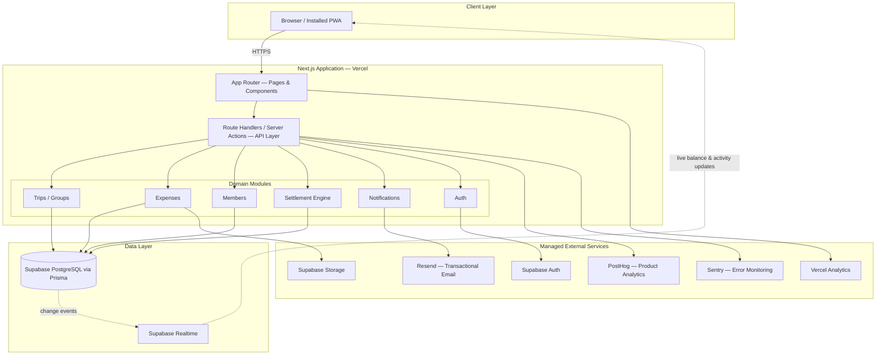
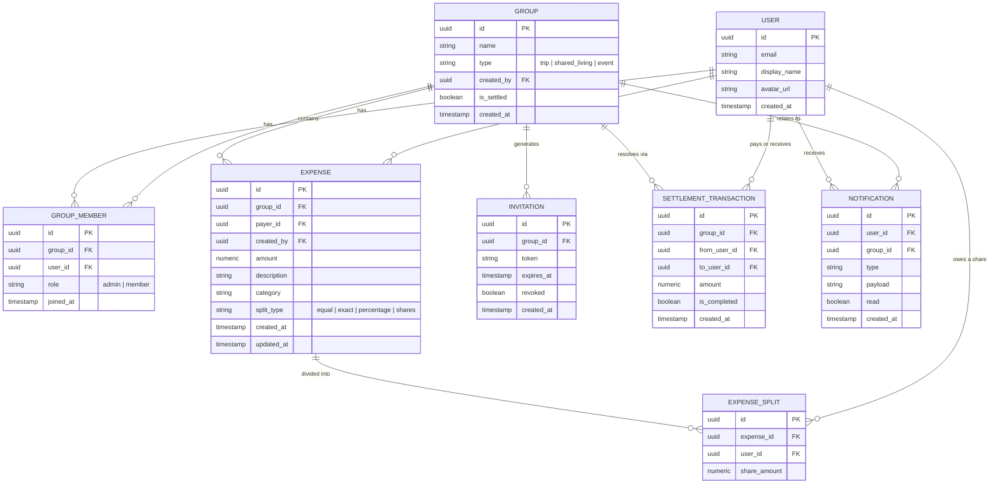

# Technical Design Document: SettleMates MVP

## Executive Summary

**System:** SettleMates | **Version:** MVP 1.0 | **Architecture:** Full-stack monolith (Next.js App Router, domain-modularized) | **Est. effort:** ~12–14 person-weeks (solo developer, matches PRD timeline — *estimate*)

SettleMates's MVP is built as a single Next.js codebase deployed to Vercel, backed entirely by managed services (Supabase for database, auth, storage, and realtime). There is no separate backend service, no containers, and no custom infrastructure to operate. The architecture is intentionally boring: a CRUD-and-collaboration SaaS with one non-trivial piece of business logic (the settlement engine), organized into clear domain modules so it stays maintainable as a solo project while remaining able to absorb more contributors or split into services later if it ever needs to.

This document defines **how** the PRD's features get built. It does not include ready-made implementations — schemas, pipelines, and test suites are intentionally left for the coding agent to generate at build time from the specs below, per the generation guardrails for this document.

---

## Architecture Overview



**Reading the diagram:** the client never talks to Supabase directly except for realtime subscriptions and authenticated storage uploads — all writes and business logic pass through the Next.js API layer (Route Handlers / Server Actions), which enforces domain rules before touching the database. Supabase Realtime pushes change events back to subscribed clients so balances feel live without polling.

---

## Tech Stack Decision

For each major decision below: alternatives considered, the recommendation, and the honest trade-off being accepted.

### 1. Platform Strategy

| Option | Pros | Cons |
|---|---|---|
| **Mobile-first PWA (chosen)** | No app-store friction or review delay; instant updates; one codebase; shareable via URL/QR, which matters for invite-driven growth | Push notifications and background sync are more limited than native, especially on iOS Safari |
| Native apps (iOS/Android) | Best possible mobile UX and full push/notification access | Two extra codebases (or React Native), app store review cycles, far more effort for a solo developer pre-PMF |
| Hybrid (Capacitor/Ionic wrapping the web app) | Gets into app stores with one codebase | Adds a build/release layer and native tooling before there's evidence it's needed |

**Recommendation:** PWA. It matches the solo-developer, fast-iteration constraint and the product's invite-link-driven growth loop. **Trade-off accepted:** notification reach on iOS is weaker than native; this is acceptable because Basic Notifications (P1) already assumes in-app/lightweight channels, not push, as the MVP baseline.

### 2. Architecture Pattern

| Option | Pros | Cons |
|---|---|---|
| **Full-stack monolith — Next.js (chosen)** | One repo, one deploy, one language, shared types end-to-end, fastest solo-developer velocity | Everything scales together; a hot path can't be scaled independently without extra work later |
| Microservices | Independent scaling and deployment per domain | Massive overhead (service boundaries, network calls, deployment orchestration) for a CRUD SaaS with one solo developer |
| Serverless functions-only (no framework) | Fine-grained scaling, pay-per-use | Loses shared typing and cohesion; more plumbing for routing, auth, and shared logic than a framework gives for free |

**Recommendation:** Monolith, with business logic split into domain modules (Trips, Expenses, Members, Settlement Engine, Notifications, Auth) so the codebase stays navigable and any domain *could* be extracted into its own service later without a rewrite. **Trade-off accepted:** if one domain (e.g., realtime balance updates) becomes a genuine bottleneck at scale, it will need to be pulled out deliberately rather than auto-scaling independently — acceptable given the 1K–10K user MVP target.

### 3. Backend / API Layer

| Option | Pros | Cons |
|---|---|---|
| **Next.js Route Handlers + Server Actions (chosen)** | No separate service to deploy or monitor; colocated with frontend; Server Actions remove boilerplate for form-style mutations | Tightly coupled to Next.js — migrating off it later means rebuilding the API layer |
| Separate Express/NestJS backend | Framework-agnostic, easier to swap frontend later | A second deployable, a second set of types to keep in sync, more infra for one developer to run |
| tRPC on top of Next.js | End-to-end type safety without hand-written REST contracts | Less conventional for third-party or future public API consumers; adds a layer on top of an already-adequate Route Handler approach |

**Recommendation:** Route Handlers for RESTful endpoints, Server Actions for internal form-style mutations (e.g., quick internal state changes not needing a stable public contract). **Trade-off accepted:** if SettleMates ever needs a public API for integrations, some Route Handlers will need versioning conventions added retroactively.

### 4. Database & Backend Services

| Option | Pros | Cons |
|---|---|---|
| **Supabase (Postgres + Auth + Storage + Realtime) (chosen)** | Relational integrity fits ledger/balance data well; auth, storage, and realtime bundled; generous free tier; minimal DevOps; AI coding assistants are well-trained on it | Vendor lock-in to Supabase's auth/realtime conventions specifically (though the underlying Postgres is portable) |
| Firebase (Firestore + Auth) | Also fully managed, strong mobile SDKs | Firestore's document model is a worse fit for relational balance/settlement queries and joins than Postgres |
| Self-hosted Postgres + custom auth | Full control, no vendor lock-in | Directly contradicts the "minimal DevOps overhead" constraint for a solo developer |

**Recommendation:** Supabase. **Trade-off accepted:** migrating off Supabase Auth/Realtime later (if ever) is real work, though the Postgres data itself remains portable since Prisma owns the schema.

### 5. ORM

| Option | Pros | Cons |
|---|---|---|
| **Prisma (chosen)** | Mature, excellent TypeScript DX, strong migration tooling, widely known by AI coding assistants | Slightly heavier runtime than lighter alternatives; less flexible for very complex raw SQL |
| Drizzle ORM | Lighter, closer to SQL, fast | Newer ecosystem, less battle-tested tooling for migrations at this stage |

**Recommendation:** Prisma, per stated preference. **Trade-off accepted:** for the settlement engine's balance aggregation queries, some logic may be easier in raw SQL/views than in the Prisma query builder — acceptable to drop to `$queryRaw` for that specific path if needed.

### 6. Realtime Layer

| Option | Pros | Cons |
|---|---|---|
| **Supabase Realtime (chosen)** | Comes free with the database choice; Postgres change-data-capture out of the box; no separate service | Coupled to Supabase; less flexible than a dedicated realtime provider for complex presence/collaboration features later |
| Pusher / Ably | Purpose-built realtime platforms, very mature | Extra vendor and cost on top of Supabase, redundant given Supabase already provides this |

**Recommendation:** Supabase Realtime. This also resolves the "WebSockets vs. SSE" question left open at the PRD stage — Supabase Realtime is WebSocket-based under the hood, so no separate decision is needed.

### Summary

- **Frontend:** Next.js (App Router) + TypeScript + Tailwind CSS + shadcn/ui + TanStack Query (server state) + React Hook Form + Zod (validation) + Framer Motion (used sparingly, for key transitions only) + Vitest/React Testing Library (test runner)
- **Backend:** Next.js Route Handlers + Server Actions + Prisma ORM, business logic organized by domain, no separate service
- **Infrastructure:** Vercel (hosting, CI/CD, analytics) + Supabase (Postgres, Auth, Storage, Realtime) + Resend (email) + PostHog (product analytics) + Sentry (error monitoring)

---

## Project Structure

```
src/
├── app/                        # App Router: pages, layouts, route handlers
│   ├── (marketing)/            # Public landing page
│   ├── (auth)/                 # Sign up, sign in, password reset
│   ├── (dashboard)/            # Authenticated shell
│   │   ├── groups/[id]/        # Group detail: expenses, settlement, activity
│   │   ├── quick-split/        # Standalone Quick Split flow
│   │   └── settings/
│   └── api/                    # Route Handlers (REST-style API layer)
├── components/                 # Shared UI (shadcn/ui-based)
├── domains/                    # Business logic, one folder per bounded context
│   ├── trips/
│   ├── expenses/
│   ├── members/
│   ├── settlement/
│   ├── notifications/
│   └── auth/
├── lib/                        # Cross-cutting: supabase client, email client, analytics client
├── db/                         # Prisma schema, migrations, seeds
├── config/                     # Env schema (Zod-validated), app constants
└── tests/                      # Vitest + RTL suites, mirroring domains/
```

Ask your coding agent to scaffold this layout and wire up path aliases when you build — it knows the current Next.js conventions.

---

## Data Model

Entity-relationship overview for the P0 entities. Field lists are the contract; exact DDL, migrations, and indexes should be generated by your coding agent from this spec.



**Relationship & cascade notes:**
- Deleting a `GROUP` cascades to `GROUP_MEMBER`, `EXPENSE`, `EXPENSE_SPLIT`, `INVITATION`, `SETTLEMENT_TRANSACTION`, and `NOTIFICATION` rows scoped to it. *(**Assumption:** hard-delete with cascade vs. soft-delete/archive is not specified in the PRD — flagged in Open Questions; soft-delete is worth considering so a group's ledger history survives an accidental delete.)*
- Deleting a `USER` should not be allowed while they have an outstanding non-zero balance in any group — this rule belongs in the Members/Auth domain logic, not just the DB constraint layer.
- `EXPENSE_SPLIT.share_amount` values for a given `EXPENSE` must sum to `EXPENSE.amount` — enforce in application logic at write time (Postgres `CHECK` constraints across rows aren't practical here).

**Indexing plan** (for your coding agent to implement in migrations):
- `GROUP_MEMBER(group_id, user_id)` — unique composite index; this is the access-control join hit on nearly every request.
- `EXPENSE(group_id, created_at DESC)` — supports the expense history / activity timeline query pattern.
- `EXPENSE_SPLIT(expense_id)` and `EXPENSE_SPLIT(user_id)` — supports both "splits for this expense" and "this user's balance across groups."
- `INVITATION(token)` — unique index, since this is the primary lookup for the join flow.
- `NOTIFICATION(user_id, read, created_at DESC)` — supports the unread-notifications query.

**Caching plan:**
- **Browser:** TanStack Query cache for group/expense/balance reads, invalidated on mutation and on incoming Realtime events.
- **CDN:** static marketing pages only; authenticated app routes are not CDN-cached.
- **Server/DB:** no Redis layer for MVP — Postgres plus TanStack Query's client cache is sufficient at 1K–10K users. Revisit if balance/settlement queries become a measured bottleneck.

---

## Feature Implementation

For each P0 feature: endpoints, request/response shape, and the business rules/side effects that matter. Full service-layer code, generated types, and pagination/query implementations are left for your coding agent to scaffold from this spec.

### F1 — Trip / Group Creation
- `POST /api/groups` — body `{ name: string, type: "trip" | "shared_living" | "event" }` → `{ id, name, type, createdBy, createdAt }`
- `GET /api/groups` — list groups the current user is a member of
- `GET /api/groups/:id` — group detail (requires membership)
- `PATCH /api/groups/:id` — update name/type (**admin only** — see Open Questions on permission model)
- `DELETE /api/groups/:id` — delete group (**admin only**)
- **Business rule:** creator is auto-inserted into `GROUP_MEMBER` with `role: "admin"` on creation.

### F2 — Member Invitations
- `POST /api/groups/:id/invitations` — body `{ expiresInDays?: number }` → `{ token, url }`
- `GET /api/invitations/:token` — public preview of group name/type before joining (no auth required to preview)
- `POST /api/invitations/:token/accept` — requires auth; inserts `GROUP_MEMBER` row
- `DELETE /api/groups/:id/invitations/:token` — admin revokes a link
- **Business rule (assumed default, flagged for confirmation):** invite tokens default to a 7-day expiry and are revocable by any group admin; multiple active tokens per group are allowed.

### F3 — Expense Management
- `POST /api/groups/:id/expenses` — body `{ amount, description, category?, payerId, splitType, splits: [{userId, shareAmount}] }`
- `GET /api/groups/:id/expenses` — paginated, reverse-chronological
- `PATCH /api/expenses/:id` — edit; recomputes splits if amount/splitType changes
- `DELETE /api/expenses/:id` — delete
- **Business rule (assumed default, flagged for confirmation):** only the expense's creator or a group admin may edit or delete it.
- **Side effect:** any create/edit/delete triggers balance recalculation (F6) and a notification event (P1) to affected members.

### F4 — Equal Split
- Handled as `splitType: "equal"` on the F3 create/edit payload — the server computes `shareAmount` per participant server-side rather than trusting client-submitted equal splits.
- **Business rule (assumed default, flagged for confirmation):** remainder cents from a non-evenly-divisible amount are allocated to the payer's share.

### F5 — Custom Split
- `splitType: "exact" | "percentage" | "shares"` on the same F3 payload.
- **Validation:** `exact` splits must sum to `amount`; `percentage` splits must sum to 100; `shares` (weights) are normalized server-side. Reject the write with a 422 if validation fails — do not silently correct it.

### F6 — Live Balance Calculation
- `GET /api/groups/:id/balances` — returns each member's net balance for the group
- **Realtime:** clients subscribe to a `group:{id}` Supabase Realtime channel; any `EXPENSE`/`EXPENSE_SPLIT` change triggers a push so TanStack Query can refetch/patch balances without polling.

### F7 — Smart Settlement Engine
- `GET /api/groups/:id/settlement` — returns the minimized `{ from, to, amount }[]` transaction list
- `POST /api/groups/:id/settlement/:transactionId/complete` — marks a suggested payment as done (supports the "Mark group complete" flow)
- **Algorithm (assumption, per PRD):** standard debt-simplification / min-cash-flow greedy approach — repeatedly match the largest creditor with the largest debtor until all balances are zero. This is a well-understood, deterministic algorithm; ask your coding agent to implement and unit-test it directly against this spec.
- **Business rule:** settlement is a *view* over current balances, not a stored final state, except for the explicit "mark complete" action on individual transactions — the group itself isn't force-closed by viewing settlement.

### F8 — Quick Split Mode
- `POST /api/quick-splits` — body `{ amount, splitType, participants: [...] }` → `{ id, shareUrl }`, no group required
- `GET /api/quick-splits/:id` — public view of the split result
- **Open question (unresolved in PRD, carried forward):** whether creating a Quick Split requires authentication or allows guest access. Recommendation for this TDD: allow **unauthenticated creation and viewing**, but require auth to convert a Quick Split into a persistent group later — this preserves the "under a minute" UX goal while still gating anything that needs to persist long-term. **This is a recommendation, not a confirmed decision — flag before building.**

---

## Security Implementation

- **Authentication:** Supabase Auth, managed. Google OAuth + Magic Link as primary flows; email/password optional. Sessions via secure, `httpOnly` cookies; Next.js middleware validates the session on protected routes.
- **Authorization:** Postgres Row-Level Security (RLS) policies scoped by `GROUP_MEMBER` membership as the primary enforcement layer, with matching checks in Route Handlers/Server Actions as defense-in-depth (never trust RLS alone for authorization logic that also has business-rule implications, like "only admins can delete").
- **Abuse protection:** rate limiting on invite creation, invite acceptance, and Quick Split creation (unauthenticated surface is the highest-risk area) — implement via Vercel Edge Middleware or a lightweight rate-limit service (e.g., Upstash). **Specific thresholds are not yet defined — treat as an estimate to tune post-launch, not a fixed spec.**
- **CORS:** restricted to the app's own origin; no public API surface in MVP.
- **CSRF:** mitigated via same-site cookies and Server Actions' built-in protections; Route Handlers performing mutations should still validate origin.
- **Security headers:** CSP, `X-Frame-Options`, `X-Content-Type-Options`, and related headers set via `next.config` — have your coding agent generate the concrete header set at build time.
- **Secrets:** all API keys and connection strings live in Vercel/Supabase environment variables, never committed to the repository.

---

## Development Workflow

**AI tool per phase** (per the team's stated strategy — a suggestion, not a hard rule):

| Phase | Primary tool |
|---|---|
| Architecture, large refactors, code review | Claude Code |
| Day-to-day implementation | Cursor |
| Product design, docs, PRDs, debugging strategy | ChatGPT |
| Rapid codegen, alternative implementations, large-context repo analysis | Gemini CLI |

**Philosophy:** AI produces the first implementation; the developer reviews, validates, and refines. Critical business logic — especially the settlement engine and balance calculations — is manually verified with unit tests regardless of which tool generated it. AI is an accelerant, not a source of truth.

**Git strategy:** GitHub, feature-branch workflow, Pull Requests even as a solo developer (keeps history reviewable and gives the AI tools clean diffs to reason about), Conventional Commits preferred.

**CI/CD:** GitHub → Vercel automatic deployments. Preview deployment on every PR; automatic production deploy from `main`. Have your coding agent generate the concrete pipeline (install → lint/typecheck → test → build → deploy) at build time for whichever CI runner you land on.

**Environments:** Local development → Preview/Staging (Vercel Preview) → Production. Separate Supabase projects for development and production once the product reaches beta, to avoid test data ever touching production balances.

---

## Testing Strategy

| Priority | Area |
|---|---|
| **High** | Settlement algorithm, balance calculations, permission/authorization logic, expense split calculations, authentication flows |
| **Medium** | API route contracts, database operations/migrations, notification triggering |
| **Lower (MVP)** | Extensive UI snapshot testing, full end-to-end coverage of every workflow |

- **Stack:** Vitest + React Testing Library, per stated preference.
- **Targets:** near-100% unit coverage on the settlement engine and split-validation logic specifically, given they're the product's core trust mechanism; ~80% overall unit coverage as a general MVP target (**estimate**, not a hard requirement); integration tests on the critical paths (create expense → balance updates → settlement reflects it); a small number of end-to-end smoke tests on the primary user journeys (create group → invite → add expense → settle) rather than exhaustive E2E coverage.
- **Visual verification:** for UI-heavy flows, generate → render → screenshot-inspect → refine before committing, and on E2E failure capture the error plus an accessibility snapshot to support AI-assisted selector repair. Your coding agent writes the actual suites at build time from this spec.
- **Note:** an E2E framework (e.g., Playwright) isn't named in the team's stated preferences — recommending it here as the conventional pairing with Vitest, but it's an **open choice**, not a locked-in decision.

---

## Deployment

**Recommended path — fully managed, matches the "minimal DevOps" constraint:**
- Application on **Vercel** — git push to deploy, automatic preview environments per PR, MVP traffic comfortably within free/low tiers.
- Database on **Supabase** (managed Postgres, Auth, Storage, Realtime bundled).
- Transactional email via **Resend**.
- Secrets stored in Vercel and Supabase environment variable stores — never committed to the repo.

Containers or cloud VMs (AWS ECS, GCP Cloud Run) are explicitly a **scale-later** option, only worth considering if a specific workload (e.g., a heavy background job) outgrows what Vercel/Supabase can do well. Your coding agent can generate a Dockerfile or IaC at that point — not needed for MVP.

---

## Cost Analysis

### Running Costs (Monthly — example stack, **all figures are rough estimates; verify on current vendor pricing pages before committing to a budget**)

| Service | Purpose | Example Tier (MVP scale) |
|---|---|---|
| Vercel | Hosting, CI/CD, analytics | Hobby → Pro if custom domains/team features are needed |
| Supabase | Postgres, Auth, Storage, Realtime | Free tier at low volume → Pro tier as the group/expense count grows |
| Resend | Transactional email | Free tier likely sufficient at MVP invite/notification volume |
| PostHog | Product analytics | Free tier (generous monthly event allowance) |
| Sentry | Error monitoring | Free/Developer tier at MVP scale |

**Note on the earlier ~$47/month figure:** this was carried over from your original PRD context rather than reconfirmed in this session. At current managed-tier pricing, a Supabase Pro + Vercel Pro combination alone can meet or exceed that figure depending on usage — worth explicitly re-confirming the budget ceiling against current pricing pages before locking in tier choices, rather than assuming the free tiers stay sufficient through all of MVP.

---

## Agent Architecture (Advanced)

The team's AI-assisted development workflow (Claude Code / Cursor / ChatGPT / Gemini CLI, described in Development Workflow above) covers **tool selection by phase**, but the deeper agentic patterns this section is meant to capture — planner-executor-reviewer loops, MCP integration points for connecting these tools to the codebase, repo, and issue tracker — were not covered in the research provided to this stage of the pipeline.

**This section is intentionally left as an Open Question (TBD)** rather than invented: if a Part 1 research document covering agentic workflows exists, its findings should be dropped in here directly. If it doesn't yet exist, define this before scaling beyond solo-developer usage of these tools.

---

## Maintenance

- **Dependencies:** favor stable, widely-adopted versions of the stack above over bleeding-edge releases; a solo-maintained project can't absorb frequent breaking upgrades.
- **Monthly review:** re-check vendor pricing tiers (Vercel, Supabase, Resend, PostHog, Sentry) and confirm nothing has silently crossed into a paid tier as usage grows.
- **AGENTS.md:** update alongside this document as coding conventions, testing rules, and repository policies solidify — this TDD intentionally defers those specifics to that file, per the PRD's Quality Standards section.

---

## Open Questions

| # | Question | Status |
|---|---|---|
| 1 | Group edit/delete permission model — admin-only, as assumed here, or a broader permission scheme? | **Assumption made — confirm** |
| 2 | Invite link expiry/revocation policy — 7-day default assumed here | **Assumption made — confirm** |
| 3 | Equal-split rounding rule — remainder assigned to payer, as assumed here | **Assumption made — confirm** |
| 4 | Quick Split authentication — guest access recommended in this TDD, not yet confirmed | **Open — needs a product decision** |
| 5 | Hard-delete vs. soft-delete/archive for groups and expenses | **Open — not specified in PRD** |
| 6 | Notification channels beyond in-app/email — is browser push in scope for MVP or P1+? | **Open — carried from PRD** |
| 7 | Budget (~$47/mo) and 12–14 week timeline — carried from earlier context, not reconfirmed this session | **Needs reconfirmation** |
| 8 | E2E test framework choice (Playwright recommended, not locked in) | **Open — recommendation only** |
| 9 | Rate-limit thresholds for invite/Quick Split endpoints | **Open — to be tuned post-launch** |
| 10 | Deeper agentic workflow patterns (planner-executor-reviewer, MCP integration) | **Open — no source research provided** |

Resolved at this stage (were open at the PRD level, now settled by this TDD's stack choices): **database provider** → Supabase; **real-time transport** → Supabase Realtime (WebSocket-based); **PWA requirement level** → confirmed P0, per the platform strategy decision.

---
*Version 1.0 | Last updated: July 31, 2026 | Next review: August 31, 2026 | Technical lead: Solo developer (SettleMates)*

---
## Handoff Context
<!-- Machine-readable summary for the next workflow step. Do not delete; the next prompt in the workflow reads this block. -->
- Stage: techdesign
- App name: SettleMates
- User level: B (developer) — *carried from earlier context, not restated in this session's input; confirm if incorrect*
- Target platform: Web — mobile-first PWA
- Budget: $47/month OPEX — *carried from earlier context, not reconfirmed this session*
- Timeline: 12–14 weeks — *carried from earlier context, not reconfirmed this session*
- Chosen stack: Next.js (App Router) + TypeScript + Tailwind + shadcn/ui frontend; Next.js Route Handlers/Server Actions + Prisma backend; Supabase (Postgres + Auth + Storage + Realtime) database/infra; Vercel hosting
- AI coding tool: Claude Code (architecture/review), Cursor (implementation), ChatGPT (design/docs), Gemini CLI (codegen/large-context)
- Source files: research-SettleMates.md → PRD-SettleMates-MVP.md → TechDesign-SettleMates-MVP.md
---
